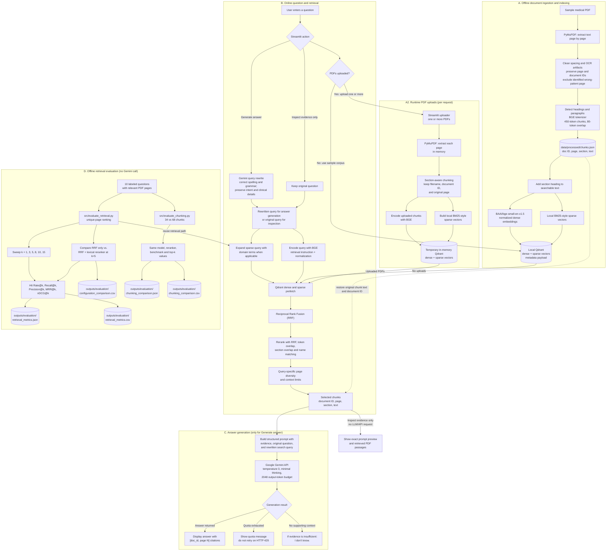

# RAG Pipeline Flow

This diagram shows the sample corpus's offline indexing path, runtime
multi-PDF upload path, online question answering, quota-free evidence
inspection, and independent retrieval evaluation.

## What the diagram means

1. **The sample corpus is indexed offline.** The bundled PDF is extracted,
   cleaned, chunked, and stored in the repository's local Qdrant index.
   Alternatively, the user can upload one or more PDFs; these are extracted
   and chunked in memory and indexed together in a temporary Qdrant instance
   for that request. They do not replace or persist in the sample corpus.
2. **For answer generation, query rewriting uses Gemini first.** It corrects
   spelling and grammar into a concise search query while preserving intent
   and clinical details. That query is embedded and expanded for sparse search
   where supported. Evidence inspection skips rewriting and searches the
   original question to remain API-free.
3. **Retrieval is local after query preparation.** Qdrant fuses dense and
   sparse results from the selected corpus (sample or uploaded PDFs) with
   RRF; the application reranks and limits the evidence sent onward. Results
   identify the source filename and original page.
4. **Evidence inspection does not use Gemini.** The UI can show retrieved
   passages and the prompt preview while the Gemini quota is exhausted.
5. **Answer generation uses Gemini.** The original question, rewritten search
   query, and retrieved chunk text with source metadata are included in the
   prompt. The full uploaded PDFs are not sent. A quota error is displayed
   without trying another model, because the project quota applies to
   generation.
6. **The evaluation runners measure retrieval only.** They compare six `k`
   settings, reranking on/off at fixed `k=5`, and the historical 34-chunk
   dataset against the current 68-chunk dataset. Chunking configurations use
   isolated temporary indexes and the same manually labeled benchmark.
   They do not call Gemini or measure query-rewrite effectiveness. Results are
   written to JSON and CSV; answer correctness and clinical safety are not
   evaluated.

## Source files

- Ingestion: [`src/text_extraction.py`](src/text_extraction.py),
  [`src/clean_text.py`](src/clean_text.py), [`src/chunk.py`](src/chunk.py),
  [`src/uploaded_documents.py`](src/uploaded_documents.py)
- Index: [`src/embedding.py`](src/embedding.py),
  [`src/sparse_vectors.py`](src/sparse_vectors.py),
  [`src/vector_database.py`](src/vector_database.py)
- Query and answer: [`src/retrieval.py`](src/retrieval.py),
  [`src/rag_pipeline.py`](src/rag_pipeline.py), [`app.py`](app.py)
- Metrics: [`src/evaluate_retrieval.py`](src/evaluate_retrieval.py),
  [`src/evaluate_chunking.py`](src/evaluate_chunking.py)
