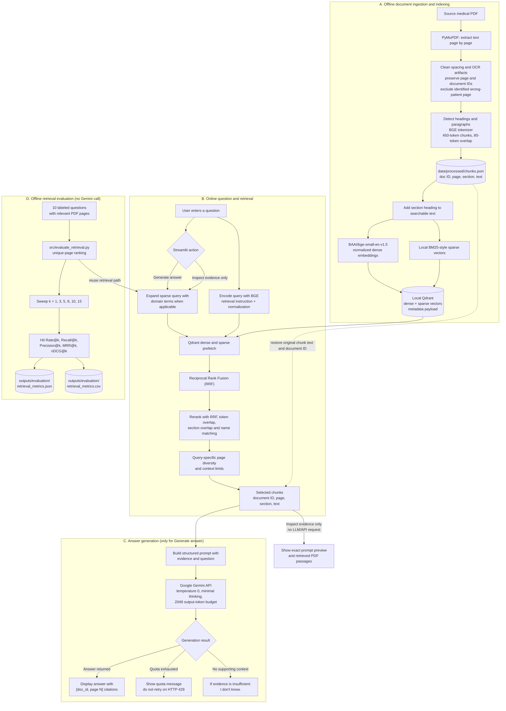

# RAG Pipeline Flow

This diagram shows the implemented offline indexing path, online question
answering path, the quota-free evidence-inspection path, and the independent
retrieval evaluation path.

## What the diagram means

1. **Indexing happens offline.** The PDF is extracted, cleaned, chunked, and
   converted into dense and sparse vectors stored in local Qdrant.
2. **At query time, retrieval is local.** The query is embedded and expanded
   for sparse search where supported. Qdrant fuses dense and sparse results
   with RRF; the application reranks and limits the evidence sent onward.
3. **Evidence inspection does not use Gemini.** The UI can show retrieved
   passages and the prompt preview while the Gemini quota is exhausted.
4. **Answer generation uses Gemini.** Retrieved chunk text and its source
   metadata are included in the prompt. A quota error is displayed without
   trying another model, because the project quota applies to generation.
5. **The evaluation runner measures retrieval only.** It compares six `k`
   settings against the manually labeled relevant-page benchmark and writes
   JSON and CSV scores. It does not evaluate answer correctness or clinical
   safety.

## Source files

- Ingestion: [`src/text_extraction.py`](src/text_extraction.py),
  [`src/clean_text.py`](src/clean_text.py), [`src/chunk.py`](src/chunk.py)
- Index: [`src/embedding.py`](src/embedding.py),
  [`src/sparse_vectors.py`](src/sparse_vectors.py),
  [`src/vector_database.py`](src/vector_database.py)
- Query and answer: [`src/retrieval.py`](src/retrieval.py),
  [`src/rag_pipeline.py`](src/rag_pipeline.py), [`app.py`](app.py)
- Metrics: [`src/evaluate_retrieval.py`](src/evaluate_retrieval.py)

